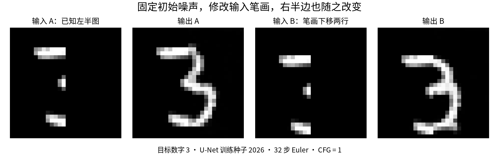
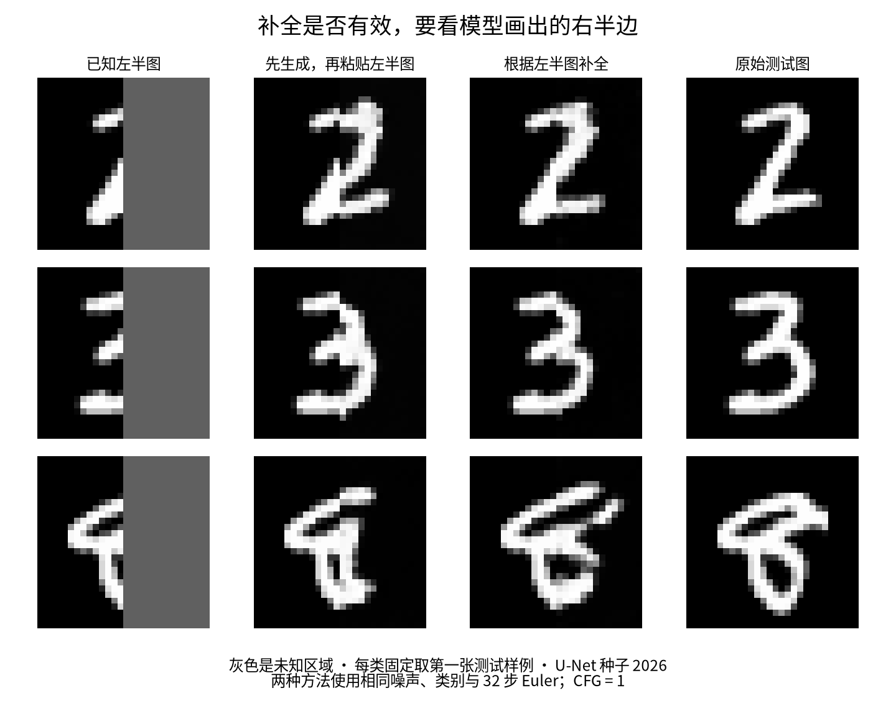

# Flow Matching Lab：修改半个数字，让模型补完

你可以修改数字的一部分，再看模型怎样画出剩下的部分。这里用真实的手写数字数据训练，生成的是 0 到 9；不是任意草图转照片的工具。



只把已知笔画向下移动两行，模型画出的右半边也发生变化。已知部分由程序保留；未知部分由网络预测。

## 直接玩

需要 Python 3.10 或更新版本。在终端运行：

```bash
git clone https://github.com/Cheongroach/flow-matching-lab.git
cd flow-matching-lab
python -m pip install -e .
python -m flow_matching_lab.download
python -m flow_matching_lab.draw
```

打开 `http://localhost:7866`。在远程开发机运行时，把端口 7866 转发到本机。下载的是训练好的模型，不需要重新训练或下载训练集。

目标数字先选 3，保持 32 步和 CFG 1。点击“载入半个真实数字”，用白笔、黑笔修改已知区域；“交给模型”将涂过的位置变为未知。“换一种补全”改变随机起点，保存按钮记录输入、输出和设置。

灰色表示未知区域。上传图片会缩小到 28×28，默认保留左半边；模型只学过手写数字，自己的草图未必能可靠补全。“噪声编辑”则修改随机起点，不要求保留画下的笔画。

## 按你关心的问题阅读

| 问题 | 文档 |
|---|---|
| 参数怎么调，怎样保存或自己训练？ | [使用说明](flow_matching_lab/README.md) |
| 为什么随机噪声能变成数字？ | [直觉与公式](flow_matching_lab/research-report-friendly.md) |
| 新版是否真的改善，89.35% 和 25% 是什么？ | [新版实验解读](flow_matching_lab/improved/results-friendly.md) |
| 原始版为何一步分数高，却缺少不同写法？ | [原始实验解读](flow_matching_lab/results-summary-friendly.md) |
| 是玩具、大作业还是 SOTA？再往上做难在哪里？ | [项目水平与下一步](flow_matching_lab/upgrade-report.md) |

`-friendly` 文档配合完整技术报告或自动数据表使用。其他说明直接更新原文件名。

## 目前的结果与范围

项目目前属于扎实的大作业 / 入门研究复现。Flow Matching 是主流方法，但这个小规模项目没有 SOTA 或生产服务证据。

新版使用处理图像空间结构的 U-Net，旧对照使用将像素摊平的 MLP。在 28×28、相同训练更新次数和固定评估输入下，32 步普通生成的类别一致率为：加宽 MLP 70.70%，U-Net 两次训练均值 89.35% ± 0.49 个百分点。这个分数来自独立数字识别器，不等于图像质量。

给真实左半图后，U-Net 补出的右半图平均绝对误差相对“先生成再粘贴”下降约 25%。参数量和计算成本未匹配，也没有为每个网络充分调参；完整解读保留加宽 MLP 补全反而更差的结果。



每种方法使用相同噪声和数字类别，原图来自测试集。图中固定取三个类别的第一张样例；全部 1,000 张评估的指标与局限见新版实验解读。

发布版通过 11 项 CPU 检查、实际 HTTP 推理检查及 [GitHub CI](https://github.com/Cheongroach/flow-matching-lab/actions/runs/40168891410)。HTTP 检查验证确定性、输入变化、已知像素保留、错误请求和保存回读。浏览器在实验环境打开页面时退出，画笔与上传等操作的自动化验证尚未通过。没有 GPU 性能实测。

## 模型下载和资料

[v0.2.0 Release](https://github.com/Cheongroach/flow-matching-lab/releases/tag/v0.2.0) 提供模型与原始生成数组。默认下载演示模型；`python -m flow_matching_lab.download --asset full` 下载全部新版实验，`--asset original` 下载原始 14×14 实验。脚本用 SHA256 校验下载完整性。

方法来源：[Flow Matching 原论文](https://arxiv.org/abs/2210.02747)、[官方 Guide](https://arxiv.org/abs/2412.06264)、[Meta 代码](https://github.com/facebookresearch/flow_matching)。完整推导、相关论文和原始配置保留在 [技术报告](flow_matching_lab/research-report.md)。

本仓库实现使用 MIT 授权，数据与方法归属原始作者。实现和文档使用 AI 辅助完成，验证范围如上。
