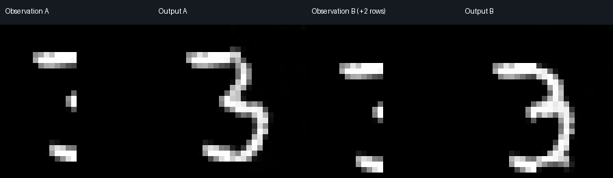
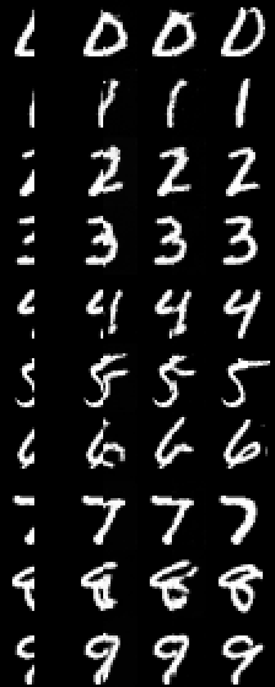
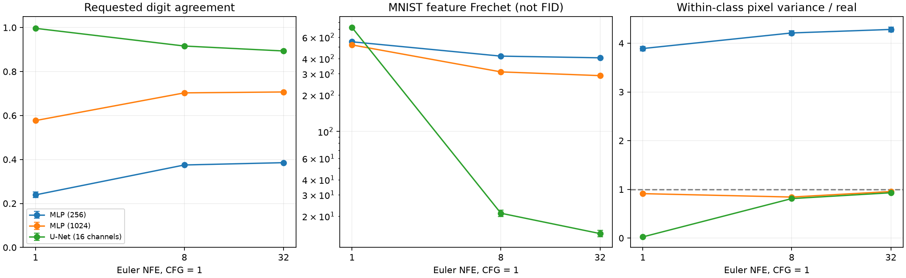

# Flow Matching Lab

从公式、真实训练到可编辑输入：一个独立的 PyTorch Flow Matching 复现项目。

**项目定位：扎实的大作业 / 入门研究复现。方法属于主流，项目没有 SOTA 证据。**

28×28 图像条件 U-Net 支持噪声编辑和笔画补全：固定种子，修改已知笔画，模型重新预测未知区域。已知区域在采样终点精确保留。原始 14×14 MLP 实验和三种训练种子的结果也保留。



图中固定噪声与数字类别，只把观察笔画向下移动两行。输出来自真实推理。



每行一个数字，列依次为：已知左半图、普通生成后粘贴、图像条件补全、真实测试图。固定样例，没有按模型效果筛选。

## 直接运行交互

```bash
git clone https://github.com/Cheongroach/flow-matching-lab.git
cd flow-matching-lab
python -m pip install -e .
python -m flow_matching_lab.download
python -m flow_matching_lab.draw
```

浏览器打开 `http://localhost:7866`。在远程开发机上运行时，转发端口 7866。

- “载入半个真实数字”观察补全；白笔、黑笔指定已知像素，“交给模型”擦除观察约束。
- 固定目标类别和种子，修改笔画，观察剩余区域如何改变。
- 上传自己的图片时，缩小为 28×28，默认保留左半边。模型只学过 MNIST 数字，照片或任意物体不在能力范围内。
- 切到“噪声编辑”，可继续调整初始噪声纹路。“换一种补全”改变种子。
- 支持恢复输入和保存输入、输出、mask、设置；保存到 `flow_matching_lab/draw_outputs/`。

源码不包含大权重；下载脚本从 [v0.2.0 Release](https://github.com/Cheongroach/flow-matching-lab/releases/tag/v0.2.0) 拉取并验证 SHA256。默认只下载演示模型；完整训练检查点和评估数组也在 Release。

## 已完成的改进与结果

新增完整 28×28 U-Net、显式图像条件和二值 mask，训练同时包含普通生成和遮挡补全。对照使用同分辨率 MLP，而非把 14×14 与 28×28 的指标混在一起。

每设置 1,000 张、32 步 Euler、CFG 1：

| 模型 | 参数量 | 训练种子 | 请求类别一致率 | MNIST 特征 Fréchet ↓ |
|---|---:|---:|---:|---:|
| 加宽 MLP，width 1024 | 9,674,256 | 1 | 70.70% | 289.15 |
| U-Net，16 channels | 236,545 | 2 | 89.35% ± 0.49% | 14.36 ± 0.88 |

U-Net 的测试半图补全：未知区域 MAE 均值 **0.2292**，普通生成后粘贴为 **0.3057**，相对降低约 **25.0%**。已知误差为 0 来自采样投影约束；补全效果必须看未知区域，不能用已知区域的零误差证明。

以上使用同数据、训练样本 RNG、batch64、3,000 次更新及评估噪声；**未匹配参数量或计算成本，也未分别充分调参**。± 是两个训练种子的样本标准差，不是置信区间。加宽 MLP 的补全 MAE 比其粘贴对照更差，完整结果公开保留。

类别一致率来自测试准确率 98.75% 的独立 MNIST CNN。特征 Fréchet / MMD 使用该 CNN，**不是 Inception FID / KID**。这些数字不能用于论文榜单比较。一步 U-Net 的类别一致率接近 99.7%，但类内像素方差只有真实数据的约 2.4%，主要产生类别原型。



详见 [全部 28×28 实测指标](flow_matching_lab/improved/results.md)、[项目级别与继续提升的难点](flow_matching_lab/upgrade-report.md)、[原始三种子实验](flow_matching_lab/results-summary.md)。

## 复现实验

```bash
python -m flow_matching_lab.image_train --architecture unet --seed 2026 \
  --steps 3000 --output flow_matching_lab/improved/my_unet
python -m flow_matching_lab.image_train --architecture mlp --width 1024 --seed 2026 \
  --steps 3000 --output flow_matching_lab/improved/my_mlp
python -m flow_matching_lab.image_eval \
  --runs flow_matching_lab/improved/my_unet flow_matching_lab/improved/my_mlp
python -m flow_matching_lab.image_aggregate
```

自动下载并校验原始 MNIST；固定 55,000 / 5,000 / 10,000 的训练、验证、测试切分。升级版在本次实验中使用 CPU；没有 GPU 性能结果。训练器支持保存优化器、EMA、随机数状态并精确恢复。

下载所有现成实验：

```bash
python -m flow_matching_lab.download --asset full
python -m flow_matching_lab.download --asset original
```

## 正确性与验证范围

```bash
python -m unittest flow_matching_lab.verify flow_matching_lab.test_images -v
python -m flow_matching_lab.http_check \
  --run flow_matching_lab/improved/unet_seed2026 \
  --output /tmp/fm-http-verification.json
```

11 项 CPU 检查通过；另有官方 `CondOTProbPath` 路径/速度逐值一致记录、精确恢复记录和实际 HTTP 推理验证。HTTP 验证覆盖输入变化、确定性、已知区域保留、非法请求拒绝及保存回读。

浏览器端绘制、上传图片和移动布局实现已提供，但本环境 Chromium 在页面导航时退出，**浏览器自动化未通过**。可选 `browser_check.py` 留作具备正常 Playwright 环境时验证。GitHub Actions 运行 CPU 正确性检查；不把 CI 配置等同于 CI 已成功运行。

## 方法与资料

\[
x_t=(1-t)x_0+t x_1,\qquad
\mathcal L=\mathbb E\|v_\theta(x_t,t,c,k,m)-(x_1-x_0)\|^2.
\]

训练端点独立采样；没有实现 minibatch OT、reflow、蒸馏或大规模 DiT。采样使用 Euler / Heun；CFG 指导类别，两条分支保留相同图像条件。

- [Flow Matching 原论文](https://arxiv.org/abs/2210.02747)
- [Flow Matching Guide and Code](https://arxiv.org/abs/2412.06264) / [Meta 官方代码](https://github.com/facebookresearch/flow_matching)
- [OT-CFM](https://arxiv.org/abs/2302.00482)
- [Stable Diffusion 3：Rectified Flow Transformers](https://arxiv.org/abs/2403.03206)
- [完整调研报告与实现入口](flow_matching_lab/research-report.md) / [运行细节](flow_matching_lab/README.md)

MIT 授权适用于本仓库实现。数据与方法归属其原始作者；MNIST 从原始公开数据镜像读取。实现与实验文档使用 AI 辅助完成，验证范围如上。
