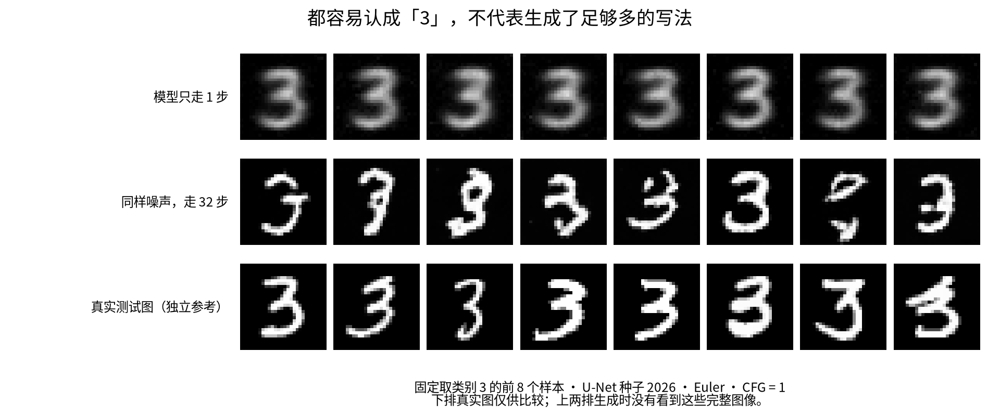

# 为什么噪声能变成数字：Flow Matching 从直觉到公式

我们想让电脑生成新的手写数字。训练时提供很多真实数字，生成时只告诉它“画一个 3”，或者再提供半个 3，让它补完。生成时没有完整答案可供照抄。

Flow Matching 的做法是：从一张随机像素图开始，让网络反复告诉我们“现在各个像素应该怎样改变”。执行这些修改后，随机图逐渐变成数字。这里的“速度”是像素值变化的速度，不是屏幕上的物体运动速度。



图中前两排来自同一组噪声。一步输出虽然容易认成 3，各张却很相似；32 步有更多不同写法。最后一排真实图仅作参考，生成前两排时没有把这些完整图当作答案。

## 训练时，我们怎样给它答案

训练一小步时，先拿一张真实数字，再生成一张随机噪声。把它们混合，就得到一张处于“噪声与数字之间”的图。因为两端都是已知的，我们可以直接算出这张中间图应该朝哪个方向变化。

举一个只看单个像素的例子：噪声像素值是 −0.8，真实图对应的像素值是 0.6。两者混合到一半时，值是 −0.1。我们要求网络预测的变化量是 `0.6 − (−0.8) = 1.4`。一张图像对所有像素同时做这件事。

模型训练时收到的是中间图、当前时间和数字类别。它不会单独看到完整的噪声端点和真实图端点。训练程序知道答案，用它来纠正网络的预测；学到的参数随后用于新的噪声。

补全任务还会把已知区域作为额外输入。例如，你提供左半个 3，模型训练时和生成时都能看到这部分，才能学习如何根据左半边决定右半边。

## 用三个符号写清楚

把起始噪声记为 $x_0$，真实训练图记为 $x_1$，进度记为 $t$。约定 $t=0$ 是噪声，$t=1$ 是真实图。它不是实际经过的秒数。

中间图和目标速度分别是：

$$
x_t=(1-t)x_0+t x_1,\qquad u=x_1-x_0.
$$

网络的预测写成 $v_\theta(x_t,t,c)$。其中 $\theta$ 是训练要调整的参数，$c$ 是数字类别。训练损失使用均方误差（MSE）：对每个像素的预测误差先平方，再在像素和训练批次中取平均。

$$
\mathcal L=\mathbb E\!\left[(v_\theta(x_t,t,c)-u)^2\right].
$$

这里的平方和平均按所有像素执行；$\mathbb E$ 表示对随机训练样本取平均。损失小，表示速度预测更接近监督目标；它不直接等于生成图片好看。

代码里的核心逻辑是：

```python
x0 = torch.randn_like(x1)           # 随机噪声
t = torch.rand(len(x1))             # 为每张图随机选一个进度
xt, target = linear_path(x0, x1, t)
loss = mse_loss(model(xt, t, labels), target)
loss.backward()                    # 计算怎样调整参数
optimizer.step()                   # 更新参数
```

每次训练只抽一个进度，不需要先完整生成一张图。这是 Flow Matching 训练方法的重要特点。[原论文](https://arxiv.org/abs/2210.02747)

## 生成时，为什么要走多步

生成时只有新噪声，没有真实终点 $x_1$。先在当前图上预测速度，修改一点图像，再在新的图上重新预测。最简单的 Euler 方法写成：

$$
x_{k+1}=x_k+\Delta t\,v_\theta(x_k,t_k,c).
$$

这里 $k$ 是当前步数，$x_k$ 是当前图像，$x_{k+1}$ 是更新后的图像。走 32 步时，$\Delta t=1/32$。把这种连续变化关系称为常微分方程（ODE）；“求解 ODE”在这里就是把预测的变化一步步执行。

Heun 方法先试走一步，在试走终点再预测一次，然后用两次预测的平均值更新。它每一步要做两次速度预测。NFE 是速度预测次数：Euler 8 步是 8 NFE，Heun 4 步也是 8 NFE。比较效率时，不能只比两个方法的步数。

训练用直线混合，并不保证生成轨迹是一条直线。网络在不同位置可能给出不同速度，因此普通训练不保证一步就能画好。[Rectified Flow](https://arxiv.org/abs/2209.03003)

## 随机噪声和真实图随便配对，会不会很矛盾

同一张中间图可能来自不同端点配对，而这些配对要求不同的速度。网络不可能同时准确猜中每一对隐藏端点。均方误差训练会倾向于预测：在当前状态、时间和类别下，所有可能目标速度的平均值。

精确表达是：

$$
u_t(x,c)=\mathbb E[x_1-x_0\mid x_t=x,c].
$$

这不是要求每个噪声找到一个唯一真实数字，而是让大量噪声经过生成后，整体分布接近真实数字的分布。原论文在相应正则性条件下证明，条件速度回归与边缘 Flow Matching 目标具有相同的参数梯度；这不保证任意有限网络和训练预算都成功。

这个解释还有一个后果：速度 MSE 不一定能降到零，因为隐藏端点本身有不确定性。有限训练集在终点也不满足所有平滑密度假设，不能把理论直接当作本实验的严格质量保证。

## 为什么一步“准确率”可能反而很高

当噪声和真实图独立抽取时，理想速度在 $t=0$ 为：

$$
u_0(x_0,c)=\mathbb E[x_1\mid c]-x_0.
$$

如果 Euler 一步从 0 走到 1，输出就变成类别平均图 $\mathbb E[x_1\mid c]$。很多个平均的 3 都容易识别，却缺少不同人的写法。

这是对理想回归目标的推导。本实验的有限网络只近似它，但观察也符合这个方向：升级版一步类别一致率约 99.65%，不同样本的类内像素方差只有真实数据的约 2.4%。32 步时类别一致率约 89.35%，方差比例约 0.93。[实测解释](improved/results-friendly.md)

因此“识别器认出来了”与“生成了真实、多样的数字”必须分开判断。

## 已知笔画为什么能保留

补全网络额外接收已知像素 $k$ 和一张标记图 $m$。标记值 1 表示已知，0 表示未知；这张标记图通常叫 mask。

生成过程中，程序每步都把已知区域放回对应的混合位置：

$$
x_t^{\mathrm{known}}=(1-t)x_0^{\mathrm{known}}+t k.
$$

上标 $\mathrm{known}$ 表示已知区域。所以到 $t=1$，该区域必然等于你提供的像素。这是程序约束，不是网络学得多好的证明。真正需要检验的是：提供已知区域后，网络画出的未知区域有没有改善。

新版在真实测试半图上，对比了“根据左半图补全”和“先完整生成，再粘贴左半图”。前者的右半图平均绝对误差下降约 25%。[对照与局限](improved/results-friendly.md)

## CFG、U-Net 和其他名字各是什么

CFG 是类别引导强度。训练时约 10% 样本不提供数字类别，让同一个网络学会有类别和无类别两种预测。生成时可把它们组合：

$$
v_{\mathrm{CFG}}=v_{\mathrm{uncond}}
+s(v_{\mathrm{cond}}-v_{\mathrm{uncond}}).
$$

$v_{\mathrm{cond}}$ 是使用数字类别的预测，$v_{\mathrm{uncond}}$ 是不使用类别的预测。`s=1` 是普通类别生成；`s=0` 不使用类别引导；`s=2` 加强类别影响。这个实现除 `s=1` 外都计算两条分支，因此每张图的网络分支评估次数翻倍。更强的类别引导可能提高识别分数，但不一定改善整体图像分布。补全模式两条分支仍接收同一已知图像。

| 名称 | 它解决哪一层问题 | 本项目是否使用 |
|---|---|---|
| Flow Matching / CFM | 怎样构造中间状态和速度监督；CFM 指条件路径训练 | 使用独立端点配对的线性 CFM |
| MLP / U-Net | 网络怎样处理图像和预测速度 | 两者都使用；新版主模型是 U-Net |
| Rectified Flow | 线性速度回归，以及用新配对继续训练的 reflow 思路 | 基础目标相关；没有实现 reflow |
| OT-CFM | 用最优传输选择批内噪声与图像配对，而非随机独立配对 | 没有实现 |
| Diffusion | 另一类生成建模方法，与 FM 在合适路径下有数学联系 | 未单独训练扩散模型 |

这里“条件路径”的“条件”与数字类别条件不是完全同一个概念。技术报告进一步区分了它们。名为 `CondOTProbPath` 的逐端点路径，也不代表我们做了两种完整分布之间的最优传输配对。

Diffusion 也能确定性生成，不能用“FM 是确定的、Diffusion 是随机的”简单区分。比较现成模型时，还要核对时间方向和网络预测的是速度、噪声还是其他量。

## 读代码与继续阅读

先看 `core.py` 中的 `linear_path` 和 `integrate`，再看 `train.py` 怎样随机抽样并计算误差。理解基础后，读 `image_model.py` 中的图像条件和已知区域保留。网络结构的细节不会改变前面几条训练与生成公式。

原始实验是 14×14 MLP；升级实验是 28×28 图像条件网络。它们有不同训练任务和预算，指标不能直接跨分辨率比较。本项目完成了方法复现和小规模对照，没有复现原论文的 ImageNet、大型文生图训练或 GPU 性能。

需要精确配置、全部理论限定和仓库对应位置时，读 [技术报告](research-report.md)。想运行，回到 [使用说明](README.md)；想判断工程价值，读 [项目水平](upgrade-report.md)。

原理参考：[Flow Matching](https://arxiv.org/abs/2210.02747)、[Rectified Flow](https://arxiv.org/abs/2209.03003)、[OT-CFM](https://arxiv.org/abs/2302.00482)、[官方 Guide](https://arxiv.org/abs/2412.06264)、[Meta 代码](https://github.com/facebookresearch/flow_matching)、[TorchCFM](https://github.com/atong01/conditional-flow-matching)、[高分辨率 Rectified Flow Transformer](https://arxiv.org/abs/2403.03206)。实验数字来自本项目运行记录，不用于与这些论文的外部指标排名。
