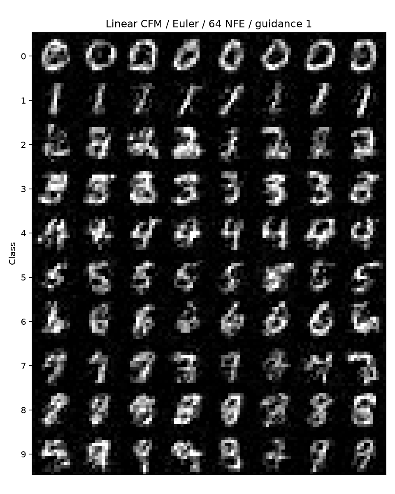
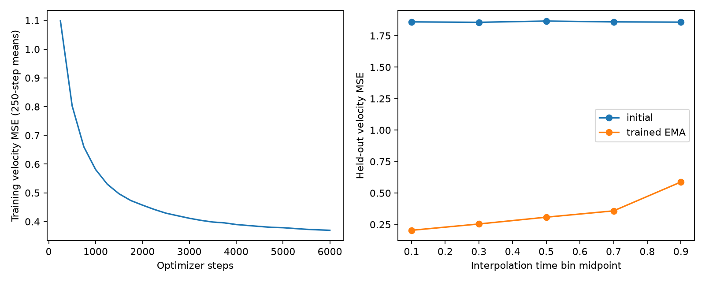
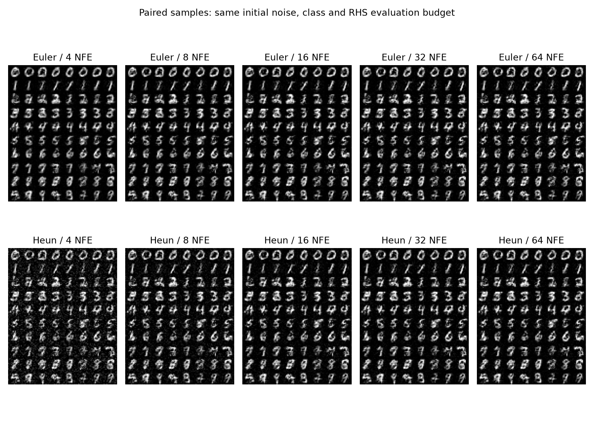
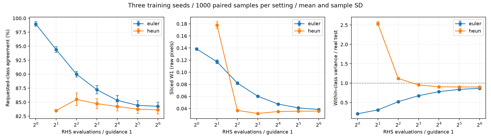
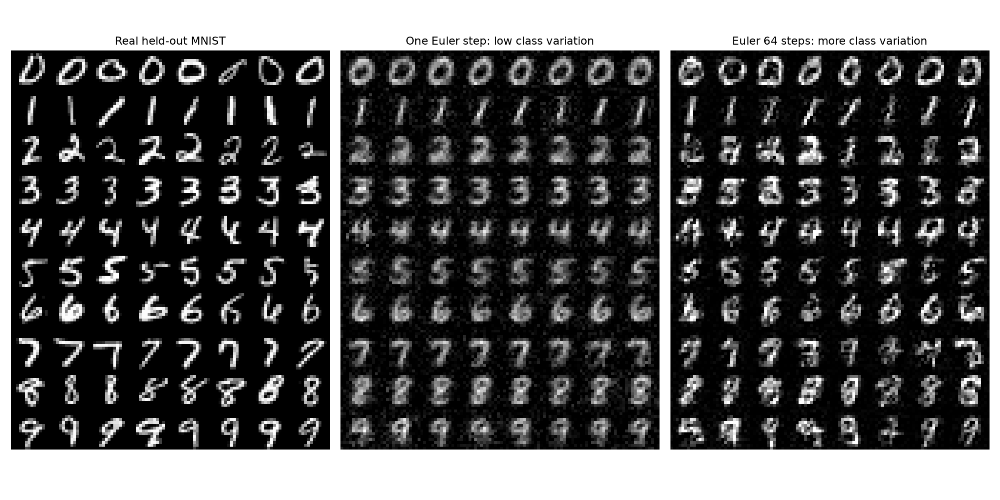
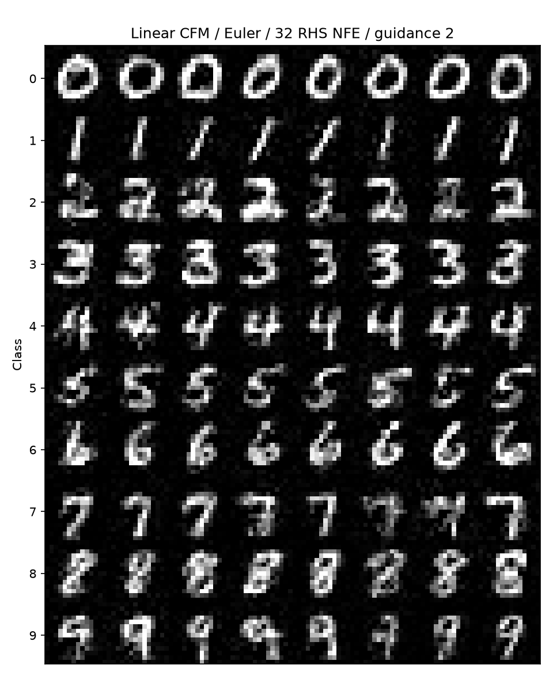
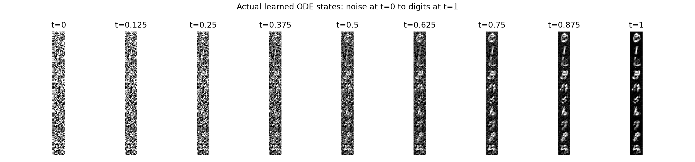

# Flow Matching 调研与 MNIST 复现

第一次阅读建议从 [直觉与公式解读](research-report-friendly.md) 开始。本篇保留原始 14×14 实验的完整技术记录；28×28 升级已经完成，见 [升级实验解读](improved/results-friendly.md)。下文末尾将 U-Net 列为后续方向，是原始实验阶段的记录，不代表当前仍未实现。

调研与实验日期：2026-10-22。研究范围为连续 Flow Matching、Conditional Flow Matching、Rectified Flow、最优传输与现有生成模型的关系；实际复现使用真实 MNIST、独立 PyTorch 实现和 CPU。论文理论与代码说明引用一手来源，实验数值来自本目录保存的运行记录。

## 方法与复现结论

Flow Matching（FM）学习一个随时间变化的速度场，将简单分布中的样本连续搬运到数据分布。关键贡献是使用可以直接构造的条件路径和条件速度训练连续归一化流，避免在每个训练步骤中求解 ODE。生成时仍然需要 ODE 积分。[cite:1][cite:4]

本次完成线性 CFM 的真实数据复现：53 万参数的条件 MLP，在 14×14 MNIST 上训练 6,000 步，运行 3 个训练种子；平均验证速度 MSE 为 **0.34288 ± 0.00097**。未训练模型的类别一致率约 12.43%，训练后 Euler 64 NFE 为 **84.27% ± 0.75%**；CFG scale 2 的 Euler 32 步为 **98.73% ± 0.35%**。这些是独立数字分类器的类别一致率，不能当成图像质量或论文 FID。



这是方法与训练流程复现。数据分辨率、模型结构、数据集、训练预算和评估指标均不同于原论文的 ImageNet 实验，没有复现论文表格、ImageNet FID 或大型文生图模型的训练结果。没有运行 GPU、分布式训练、minibatch OT 或 reflow。

## 从 ODE 到速度回归

### 生成模型表示什么

设 \(x_0\sim p_0\)，通常取标准高斯噪声。定义：

\[
\frac{d x_t}{dt}=v_\theta(x_t,t,c),\qquad t\in[0,1].
\]

这里 \(c\) 可以是类别、文本或语音条件；本实验取数字类别。模型输入是当前状态、时间与条件，输出与状态同形状的速度。对一个噪声样本积分至 \(t=1\)，得到生成样本；全部噪声样本经过这张流映射形成生成分布。[cite:1][cite:4]

速度场驱动的密度满足连续性方程：

\[
\partial_t p_t(x)+\nabla\cdot[p_t(x)u_t(x)]=0.
\]

FM 的任务是学习产生目标概率路径 \(p_t\) 的速度场 \(u_t\)。这是一种训练目标与路径构造方法，网络可以使用 MLP、U-Net 或 Transformer；FM 本身不指定网络架构。[cite:1][cite:4][cite:7]

### 最小线性路径

从数据中抽取 \(x_1\)，独立生成 \(x_0\)，再抽取 \(t\sim U(0,1)\)：

\[
x_t=(1-t)x_0+t x_1,\qquad \dot x_t=x_1-x_0.
\]

因此监督信号可以直接计算，无需先运行生成模型。损失为：

\[
\mathcal L_{\mathrm{CFM}}(\theta)=
\mathbb E\big[\|v_\theta(x_t,t,c)-(x_1-x_0)\|^2\big].
\]

本实验按 batch 与像素求平均 MSE。Meta 官方 `CondOTProbPath` 使用 \(\alpha_t=t\)、\(\sigma_t=1-t\)，与此构造完全一致。[cite:2][cite:5]

训练的核心是以下几行：

```python
x0 = torch.randn_like(x1)
t = torch.rand(len(x1), device=x1.device)
xt, target = linear_path(x0, x1, t)
loss = torch.nn.functional.mse_loss(model(xt, t, labels), target)
loss.backward()
optimizer.step()
```

其中 `model` 看不到单独的 `x0` 与 `x1`，它只能依据当前 `xt`、时间和条件预测速度。生成时没有真实 `x1`，从新噪声开始重复更新当前状态。[cite:1][cite:5]

### 为什么随机配对也能学习正确的边缘分布

多条训练直线可能经过相同的中间位置，却有不同速度。均方误差回归的最优预测是条件期望：

\[
u_t(x,c)=\mathbb E[x_1-x_0\mid x_t=x,c].
\]

将每对端点的简单路径边缘化后，得到希望拟合的中间分布；上述条件期望速度场满足该边缘路径的连续性方程。原论文证明，在相应正则性假设下，CFM 与无法直接计算的边缘 FM 损失仅相差一个不依赖模型参数的常数，因此梯度相同。[cite:1][cite:3]

这个结论解释了为什么训练不需要知道全局密度或全局目标速度。它也解释了为什么 **CFM 回归 MSE 不必趋近 0**：端点配对在给定中间状态后仍可能有不可消除的条件方差。训练直线并不要求推理时的所有轨迹也是直线。[cite:1][cite:2]

本实现没有给真实像素终点增加残余噪声；有限数据集在终点的密度正则性不能直接等同于原论文的平滑正密度假设。本次验证的是采样和回归行为，没有进行精确似然估计。

## 论文脉络与概念区别

| 工作 | 核心内容 | 复现或阅读入口 |
|---|---|---|
| Flow Matching，2022 / ICLR 2023 | 用条件路径回归训练 CNF；包含 diffusion 路径和 conditional OT 路径 | 原论文第 3、4 节。[cite:1] |
| Rectified Flow，2022 / ICLR 2023 | 线性端点插值的速度回归；通过 reflow 逐轮调整耦合、拉直轨迹 | 原论文第 2、3 节。[cite:2] |
| OT-CFM，2023 / TMLR 2024 | 利用端点之间的 minibatch OT 耦合构造更简单的流 | TorchCFM 的 OT matcher。[cite:3][cite:6] |
| Flow Matching Guide and Code，2024 | 系统整理连续、离散与其他扩展；提供 PyTorch 路径、损失、求解器 | Meta 官方教程与库。[cite:4][cite:5] |
| SD3 / Rectified Flow Transformer，2024 | 研究时间采样、条件建模与高分辨率 Transformer 的规模化效果 | 论文方法与消融。[cite:7] |

### FM 与 diffusion

FM 可以直接指定 \(x_t=\alpha_t x_1+\sigma_t x_0\) 和导数 \(\dot x_t\)，包含多种 diffusion 概率路径作为特例。Diffusion 中的 score、noise、clean sample 与速度表示，在合适路径下可以相互转换；不能仅凭变量叫 `noise_pred` 判断模型预测的量。[cite:1][cite:4][cite:5]

常见 diffusion 代码把时间定义为数据到噪声，而本报告定义为噪声到数据。比较训练公式和 scheduler 时必须同时核对时间方向、参数化和更新符号。Diffusion 也可以通过 probability flow ODE 或 DDIM 进行确定性采样，所以“FM 用 ODE、diffusion 只能用随机 SDE”是不正确的区分。[cite:2][cite:4]

### FM、Rectified Flow 与 OT-CFM

基本 Rectified Flow 的线性速度回归，与这里独立配对的线性 CFM 在相同约定下使用相同形式的目标。Rectified Flow 更强调 reflow：用已有流得到新的噪声与输出配对，再训练下一轮流；这些配对与最初独立抽样不同。[cite:2][cite:3]

条件 OT 到一个数据点的直线路径，并不意味着两种完整分布之间的耦合最优。独立配对 \(p_0(x_0)p_1(x_1)\) 与最优传输计划 \(\pi(x_0,x_1)\) 必须区分；minibatch OT 则是全局 OT 的有限批近似。TorchCFM 文档明确区分 `TargetConditionalFlowMatcher` 与 `ExactOptimalTransportConditionalFlowMatcher`。[cite:3][cite:6]

### 直线监督不自动得到一步生成

若学到的实际轨迹是直线且速度沿轨迹不变，Euler 一步就能完成精确位移。但普通独立配对训练不保证这种条件。少步生成可以依赖 reflow、蒸馏、网络能力与具体数据分布，本次没有实现这些改进。[cite:2]

在 \(t=0\) 且端点独立时：

\[
u_0(x_0,c)=\mathbb E[x_1\mid c]-x_0.
\]

理想的一步 Euler 输出是 \(x_0+u_0(x_0,c)=\mathbb E[x_1\mid c]\)，即类别均值。这给出本实验“一步类别一致率高但类内方差低”的理论解释。有限网络只近似这一极限，实测结果不能替代对更复杂数据和训练方法的验证。

## 实验设计与可复现条件

| 项目 | 本次实际配置 |
|---|---|
| 运行环境 | Python 3.11.2、PyTorch 2.9.1、NumPy 2.3.5、Matplotlib 3.11.1、Pillow 11.3.0 |
| 设备 | CPU，单运行 4 个 intra-op 线程；没有可用 CUDA GPU |
| 数据 | 原始 MNIST 四个 gzip IDX 文件；逐文件 MD5 校验，记录 SHA256 |
| 图像处理 | 28×28 平均池化到 14×14，像素缩放至 [-1,1]，展平成 196 维 |
| 数据切分 | 官方训练集固定划分 55,000 train / 5,000 validation；官方 10,000 test 保持独立 |
| 速度网络 | 宽度 256、3 个 residual block、时间特征 65 维、类别 embedding 64 维，共 530,820 参数 |
| 优化 | AdamW，学习率 0.001，weight decay 0.0001，batch 256，梯度裁剪 1.0 |
| 条件训练 | 10% 标签丢弃，空条件标签为 10 |
| EMA | decay 0.995，评估使用 EMA 权重 |
| 训练种子 | 2026、2027、2028；各训练 6,000 步 |
| 评估采样 | 每设置 1,000 张、每类 100 张；三个模型共用噪声种子 123456 |
| 数值方法 | Euler、Heun；相同 RHS NFE 进行配对对比 |
| 分类器 | 独立 MLP，仅用真实训练图像训练；官方测试集准确率 97.02% |

原始压缩 MNIST、临时预跑、运行日志和校验中间文件位于 `/tmp`；用户需要保留的模型、生成数组和报告保存在 `flow_matching_lab/`。模型训练看不到 test 数据。测试参考用于最终评估及描述性比较；没有独立的第二套 test 来确认事后选出的“最佳采样器”，因此 Heun 8 NFE 的观察不作为普适最优配置。

三个模型的参数更新共 18,000 步。每个模型评估 13 个普通条件 solver 设置、2 个 CFG 设置，正式生成结果共 **45,000 张**；另有未训练基线和可视化轨迹。每张图像来自实际积分，不是插值伪装或筛选最佳样本。

## 实测结果与解释

### 训练验证

| 训练种子 | 初始验证 MSE | 最终 EMA 验证 MSE | 本次训练耗时 |
|---|---:|---:|---:|
| 2026 | 1.859825 | 0.342518 | 45.39 s |
| 2027 | 1.859608 | 0.342154 | 54.19 s |
| 2028 | 1.862467 | 0.343978 | 52.66 s |

以上耗时来自共享 CPU，部分运行重叠，仅说明实验成本。不能据此比较不同模型或硬件的训练性能。



固定验证集对相同图像、噪声和时间点计算 MSE。第一组最终在五个时间区间的 MSE 分别约 0.204、0.254、0.308、0.358、0.588，接近数据终点时更高。这个现象包含条件回归的不可消除方差与有限网络误差，不能直接归因于某一个训练故障。

### 采样、类别一致率与多样性

下表均为 3 个训练种子的均值 ± 样本标准差。Sliced W1 是固定 128 个单位方向上、对原始像素计算的经验一维 W1 平均；方差比是各类别内逐像素方差的均值除以真实均衡 test 数据的对应方差。它们是本实验的辅助诊断，均不是 FID 或可靠的人类感知质量指标。

| 配置 | RHS NFE | 类别一致率 | Sliced W1 ↓ | 类内像素方差 / 真实数据 |
|---|---:|---:|---:|---:|
| 未训练 Euler | 32 | 12.43% ± 0.31% | 0.72965 ± 0.00120 | 6.457 ± 0.002 |
| Euler，无 CFG 增强 | 1 | 98.97% ± 0.40% | 0.13845 ± 0.00174 | 0.209 ± 0.007 |
| Euler，无 CFG 增强 | 8 | 87.23% ± 0.75% | 0.06042 ± 0.00128 | 0.675 ± 0.008 |
| Euler，无 CFG 增强 | 64 | 84.27% ± 0.75% | 0.03842 ± 0.00076 | 0.867 ± 0.007 |
| Heun，无 CFG 增强 | 8 | 84.73% ± 0.90% | 0.03187 ± 0.00093 | 0.953 ± 0.012 |
| Euler，CFG scale 2 | 32 | 98.73% ± 0.35% | 0.06179 ± 0.00144 | 0.857 ± 0.014 |

作为距离尺度参考，独立抽取的 1,000 张均衡真实 train 图像与 test 图像的 Sliced W1 为 0.02780。有限样本之间本来就有非零距离，该值不是精确的可达下界。



一步 Euler 的类别一致率高，但类内方差只有真实数据的约 21%；增加步数降低距离、恢复样本变化，同时类别一致率下降。解释是模型更接近完整数字分布，分类器的偏差和生成错误也更容易出现。仅看“accuracy 高”无法证明模型分布拟合更好。

Heun 8 NFE 在这组三种训练种子中取得较低的 Sliced W1，方差比接近真实数据。增加 NFE 后，该距离并不单调改善：求解器逼近的是有限网络的 ODE，数值更精确并不保证真实分布指标更好。端点的速度外推、有限模型误差和距离估计波动均可能影响结果，本次没有进一步做原因消融。





### CFG 与计算量

本实现使用：

\[
v_{\mathrm{CFG}}=v_{\mathrm{null}}+s(v_{\mathrm{cond}}-v_{\mathrm{null}}).
\]

`scale=1` 只计算条件分支；`scale=0` 输出无条件速度；`scale=2` 加强类别条件。当前实现对 scale 0 和 2 都拼接两分支计算，因此 32 次 guided RHS 调用各对应每样本 64 次网络分支评估。Scale 0 可以专门优化为只计算无条件分支，本次保留统一实现并明确记账。



CFG scale 2 的类别一致率较高，但 Sliced W1 比普通条件 Euler 64 NFE 更差。这是不同生成分布之间的取舍，不应直接解释为求解器效率或感知质量提升。其平均像素截断位移约 0.0483，普通条件 Euler 64 NFE 约 0.0339。真实像素边界为 [-1,1]，生成状态常在背景附近略有越界；本实验只在显示和分类时截断，原始状态、数组与 W1 保持未截断。

## 实际生成轨迹



动画文件：[33 帧噪声到数字生成](results/seed2026/figures/generation.gif)。每帧来自真实 Euler 积分状态；所有帧使用同一批初始噪声及条件，没有使用真实图像作为生成终点。若把图中左端噪声与右端输出直接插值，那只能展示训练路径，不等于模型生成轨迹。

## 代码验证与源码阅读

### 已完成的正确性检查

| 验证 | 实际结果 |
|---|---|
| 线性路径端点与有限差分导数 | 通过 |
| Gaussian 边缘速度场的解析终点 | Euler / Heun 符合预期；同 NFE 下 Heun 误差更低 |
| 积分方向、常速度精确更新、NFE 计数 | 通过 |
| CFG scale 0 / 1 / 2 的解析结果 | 通过 |
| 无效 solver 配置处理 | 通过 |
| 官方 `flow-matching==1.0.10` 路径对照 | 三种形状下路径值与速度值误差均为 0 |
| 40 步连续 vs 20+20 步恢复 | 模型、EMA、优化器张量、RNG 状态逐值一致 |

记录见 [verification.json](verification.json) 与 [resume-verification.json](resume-verification.json)。这些校验针对本次最小实现；没有验证完整 vLLM runtime、CUDA 路径或分布式设备行为。

建议阅读顺序：`core.py:13–17` 的路径构造，`train.py` 的随机抽样与 MSE，`core.py:77–101` 的积分，再阅读条件丢弃、CFG 和 EMA。总训练目标很短，最容易犯错的是时间、速度符号、条件处理和评估口径。

### 与 vllm-omni 仓库的对应关系（原始静态阅读记录）

这些路径属于外部 vllm-omni 工作区，不包含在独立的 flow-matching-lab 仓库内。行号是原始阅读时的位置，后续代码可能变化，查找时以函数名为准。

| 文件 | 代码位置 | 对应概念 |
|---|---|---|
| `vllm_omni/diffusion/models/schedulers/scheduling_flow_match_euler_discrete.py` | `scale_noise`；`step` 中 506–518 行 | 以噪声水平 sigma 编排路径，普通分支 `dt=sigma_next-sigma`，更新 `sample+dt*model_output` |
| `vllm_omni/diffusion/models/flux/pipeline_flux.py` | `prepare_timesteps`；`diffuse` 中 477–486 行 | latent、条件、速度模型与 scheduler 的采样循环 |
| `vllm_omni/model_executor/models/indextts2/s2mel/modules/flow_matching.py` | 113 行时间网格；209–241 行 Euler / CFG | 噪声到 mel 状态，正向 t=0→1；条件与无条件分支合并 |
| `vllm_omni/diffusion/utils/flow_matching.py` | 文件整体 | 当前主要是数值求解辅助与时间编码，不是 FM 训练器 |

仓库 FlowMatch Euler 的常规 sigma 从 1 降到 0，`dt` 为负；本实验 t 从 0 增到 1，`dt` 为正。若用 sigma=1−t 重参数化，则对 sigma 的速度与对 t 的速度符号相反。迁移模型权重或修改 scheduler 时应核对训练时输出定义，而非直接复用本实验的正号更新。

IndexTTS2 的 CFG 写为 `(1+rate)*v_cond-rate*v_null`，等价于本实验的 scale=`1+rate`。它还处理语音 prompt mask、长度、conditioning 和精度；不能只替换 solver 就当成完整语音系统复现。这些对应关系来自当前本地文件的静态阅读，没有运行大模型推理。

## 继续复现与训练 Infra 的方向

先用 [README](README.md) 的两条命令重新训练和评估，可核查相同噪声下的结果。如果目标是模型方法研究，可依次扩大至 28×28 U-Net，再做 CIFAR-10、标准 FID/precision/recall、时间采样与 reflow 对照；CPU MNIST 的选型结论不要直接搬到大型图像模型。[cite:2][cite:5][cite:6][cite:7]

如果目标是训练 Infra，FM 训练可以按单时间点的普通监督学习组织；推理则需多次执行整张速度网络。值得测量的问题包括 NFE 与 CFG 带来的实际网络开销、不同图像 token 长度的 padding、graph/compile、batch 调度、模型权重与数据加载，以及生成与训练并行的资源安排。本次没有实测这些性能优化，它们是后续实验方向。

本次得到的工程基础包括自校验数据加载、严格数据切分、可恢复训练、EMA、固定噪声配对评估、独立分类器与完整采样数组。它足以支持理解 FM 并开始方法消融；成为论文或强简历成果，还需要明确的新问题、受控实验与更强的数据集验证。

## 交付文件与来源

- [运行说明](README.md)、[全部实测汇总](results-summary.md)、[机器可读汇总](results-summary.json)、[逐种子采样数据](all-sampling-metrics.csv)。
- `results/seed2026`、`seed2027`、`seed2028` 各含模型 checkpoint、训练和评估 JSON、原始 `samples.npz`、图表与动画。
- 下列论文与代码是原理来源；性能数字仅来自本地实测记录，不引用网页中的外部指标作比较。

<a id="cite-1"></a>[cite:1] Lipman et al. *Flow Matching for Generative Modeling*. 2022 / ICLR 2023. https://arxiv.org/abs/2210.02747 ; 阅读全文：https://arxiv.org/html/2210.02747v2

<a id="cite-2"></a>[cite:2] Liu et al. *Flow Straight and Fast: Learning to Generate and Transfer Data with Rectified Flow*. 2022 / ICLR 2023. https://arxiv.org/abs/2209.03003 ; https://arxiv.org/html/2209.03003v1

<a id="cite-3"></a>[cite:3] Tong et al. *Improving and generalizing flow-based generative models with minibatch optimal transport*. TMLR 2024. https://arxiv.org/abs/2302.00482

<a id="cite-4"></a>[cite:4] Lipman et al. *Flow Matching Guide and Code*. 2024. https://arxiv.org/abs/2412.06264

<a id="cite-5"></a>[cite:5] Meta 官方代码及文档。https://github.com/facebookresearch/flow_matching ; https://facebookresearch.github.io/flow_matching/ ; 关键路径源码：https://raw.githubusercontent.com/facebookresearch/flow_matching/main/flow_matching/path/affine.py ; scheduler：https://raw.githubusercontent.com/facebookresearch/flow_matching/main/flow_matching/path/scheduler/scheduler.py

<a id="cite-6"></a>[cite:6] TorchCFM 官方代码与方法说明。https://github.com/atong01/conditional-flow-matching

<a id="cite-7"></a>[cite:7] Esser et al. *Scaling Rectified Flow Transformers for High-Resolution Image Synthesis*. 2024. https://arxiv.org/abs/2403.03206

数据下载来源与每文件 MD5/SHA256 保存在各运行的 `training.json` 的 `data_manifest` 中；使用 torchvision 常用的原始 IDX 镜像：https://ossci-datasets.s3.amazonaws.com/mnist/ 。
